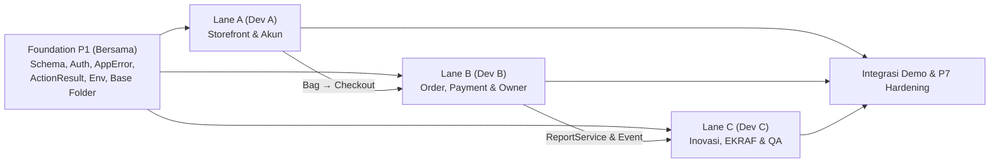
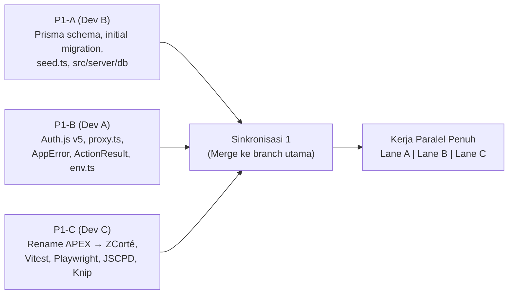

# Kepemilikan Tim & Pembagian 3 Lane Paralel

Dokumen ini membagi pekerjaan **ZCorté R0 (Competition MVP)** untuk **3 developer** agar dapat bekerja secara paralel setelah Foundation P1 selesai tanpa saling menghalangi atau menimbulkan konflik merge.

> **Tindak lanjut tim:** Ganti placeholder `Dev A`, `Dev B`, `Dev C` dengan nama dan username GitHub masing-masing anggota tim pada awal sprint (D-08 di [prd/01-overview.md](../../prd/01-overview.md)).

## 1. Alur Kerja Tim (Foundation → Paralel → Hardening)

## 2. Fase Foundation P1 (3 Sub-PR Paralel Ringan Sebelum Lane Penuh)

Agar ketiga developer langsung produktif sejak hari pertama tanpa saling menunggu, **Foundation P1** dipecah menjadi 3 sub-PR paralel yang menyentuh file berbeda dan bertemu di **Sinkronisasi 1**:

- **P1-A (`Dev B`):** `prisma/schema.prisma`, initial migration, `prisma/seed.ts` (bootstrap 3 koleksi + 6 produk awal + 1 akun `OWNER` + 1 akun `CUSTOMER` demo), dan `src/server/db/` (Prisma client singleton & helper transaksi).
- **P1-B (`Dev A`):** `src/server/auth/` (Auth.js v5 + `requireUser()` + `requireRole("OWNER")` + `src/proxy.ts`), `src/server/lib/` (`AppError`, `ErrorCode`, structured logger, `rate-limit`, `idempotency`), `src/lib/action-result.ts`, dan `src/config/env.ts` (Zod env validation).
- **P1-C (`Dev C`):** Instalasi dan konfigurasi quality gates P1 (`vitest`, `@playwright/test`, `jscpd`, `knip`) serta migrasi nama brand dasar `APEX` → `ZCorté` di layout/header/footer/constants (lihat [prd/17-appendix.md](../../prd/17-appendix.md) Lampiran B).

> **Review otomatis GitHub:** Pemetaan kepemilikan folder dan kontrak bersama juga tersedia di [.github/CODEOWNERS](../../.github/CODEOWNERS). Aktifkan barisnya begitu username GitHub ketiga developer selesai diisi (`D-08`).

## 3. Pembagian 3 Lane Paralel

| Lane & PIC           | Fokus Area                            | FR yang Dimiliki                                                                                                                                                                      | Folder & Modul Utama                                                                                                                                                                                                                                                                                                                                                                  | Reviewer Utama    |
| -------------------- | ------------------------------------- | ------------------------------------------------------------------------------------------------------------------------------------------------------------------------------------- | ------------------------------------------------------------------------------------------------------------------------------------------------------------------------------------------------------------------------------------------------------------------------------------------------------------------------------------------------------------------------------------- | ----------------- |
| **Lane A** (`Dev A`) | Storefront, Katalog, Bag, Auth & Akun | `FR-001`, `FR-002`, `FR-003`, `FR-004`, `FR-005`, `FR-006`, `FR-010`, `FR-011` _(Should)_, `FR-012` _(Should)_, `FR-013` _(Could)_                                                    | `src/app/(storefront)/(kecuali checkout & about)`, `src/app/(auth)/**`, `src/app/(account)/(kecuali orders)`, `src/app/api/products/search/**`, `src/app/api/cart/**`, `src/server/services/{product,cart,wishlist,address,auth}.service.ts`, `src/actions/{cart,auth,address,wishlist}.actions.ts`                                                                                   | `Dev B` / `Dev C` |
| **Lane B** (`Dev B`) | Checkout, Order, Payment & Owner Ops  | `FR-007`, `FR-008`, `FR-009`, `FR-020`, `FR-021`, `FR-022` _(Should)_, `FR-023`, `FR-024`, `FR-025` _(Should)_, `FR-026` _(Could)_, `FR-027a` _(Must)_, `FR-027b` _(Could)_, `FR-044` | `src/app/(storefront)/checkout/**`, `src/app/(account)/account/orders/**`, `src/app/(owner)/admin/(kecuali telegram)`, `src/app/api/payments/**`, `src/app/api/orders/**`, `src/app/api/admin/reports/**`, `src/server/services/{order,payment,inventory,report,audit,setting}.service.ts`, `src/server/integrations/{payment,shipping}/**`, `src/actions/{order,admin-*}.actions.ts` | `Dev A` / `Dev C` |
| **Lane C** (`Dev C`) | Inovasi, EKRAF, Telegram & QA Harness | `FR-030`, `FR-031`, `FR-033`, `FR-034` _(Should)_, `FR-035` _(Could)_, `FR-036`, `FR-040` _(R1)_, `FR-041`, `FR-042`, `FR-043` _(R1)_, harness E2E/a11y                               | `src/app/(storefront)/about/**`, `src/app/(owner)/admin/telegram/**`, `src/app/api/{ai,telegram,cron}/**`, `src/server/services/{assistant,outfit,size,notification,story}.service.ts`, `src/server/integrations/{assistant,telegram}/**`, `src/components/compound/Chat*`, `tests/e2e/**`                                                                                            | `Dev A` / `Dev B` |

> **Aturan batas folder:** Jika Anda berada di satu lane dan perlu mengubah komponen bersama (mis. `ProductCard` milik Lane A atau `DataTable` milik Lane B), buat PR kecil terpisah atau **tag pemilik lane terkait sebagai reviewer** di PR Anda.

## 4. Daftar Kontrak Bersama & Pemiliknya

Kontrak berikut dipakai lintas lane. Perubahan pada kontrak ini harus melalui PR berlabel `contract` dan diumumkan sebelum merge:

| Kontrak Bersama                                 | Lokasi                                                             | Pemilik Koordinasi                                  | Konsumen Lintas Lane                                                      |
| ----------------------------------------------- | ------------------------------------------------------------------ | --------------------------------------------------- | ------------------------------------------------------------------------- |
| Skema Database & Migration                      | `prisma/schema.prisma`                                             | `Dev B` (dibantu semua)                             | Semua lane                                                                |
| `ActionResult<T>` & `ErrorCode`                 | `src/lib/action-result.ts`, `src/server/lib/errors.ts`             | Koordinator P1                                      | Semua Server Action, Route Handler, & ViewModel                           |
| `AuthContext`, `requireUser`, `requireRole`     | `src/server/auth/*`                                                | `Dev A`                                             | Semua service layer                                                       |
| DTO Produk & Varian (`ProductCard`, `CartItem`) | `src/models/types/product.ts`, `cart.ts`                           | `Dev A`                                             | Lane A (PDP/Bag), Lane B (Checkout), Lane C (Assistant/Outfit)            |
| `ReportService` & `NotificationService` API     | `src/server/services/report.service.ts`, `notification.service.ts` | `Dev B` (`Report`), `Dev C` (`Notification`)        | Lane B (`/admin` & trigger event order/stok), Lane C (Telegram Simulator) |
| `StoreSetting` & `StoryStep` schema/DTO         | `src/server/services/setting.service.ts`, `story.service.ts`       | `Dev B` (Admin form), `Dev C` (Storefront `/about`) | Lane A (Home section), Lane B (`/admin/settings`), Lane C (`/about`)      |
| Design Tokens & UI Primitives                   | `src/app/globals.css`, `src/components/atoms/*`, `ui/*`            | `Dev A`                                             | Seluruh UI Storefront & Admin                                             |

## 5. Titik Sinkronisasi Lintas Lane

1. **Sinkronisasi 1 (Akhir P1):** Pastikan `schema.prisma`, `ActionResult`, `AuthContext`, dan seed database berjalan di laptop ketiga developer.
2. **Sinkronisasi 2 (Pertengahan):** Lane A memastikan format bag/varian siap dibaca `placeOrder` Lane B; Lane B memastikan `ReportService` dan event domain (`ORDER_PAID`, `LOW_STOCK`) siap dikonsumsi Simulator Telegram Lane C.
3. **Sinkronisasi 3 (P7 Hardening):** Ketiga lane menguji alur demo 5 menit bersama-sama (`prd/07-mvp-prototype-plan.md §Z.4`), menjalankan full E2E + a11y + viewport test, serta memastikan `pnpm check` & `pnpm build` hijau.
