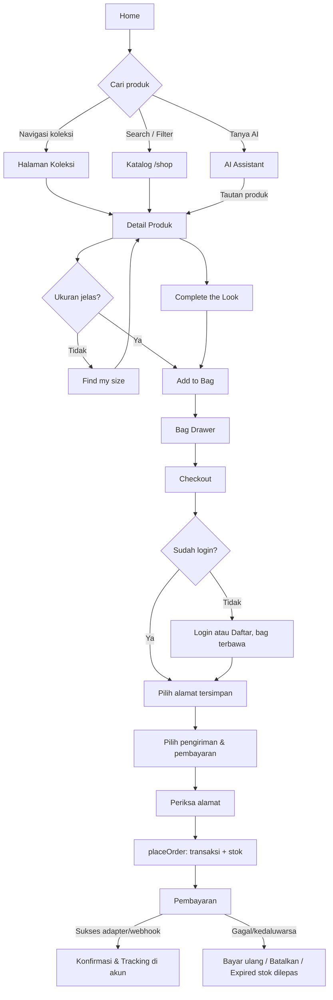
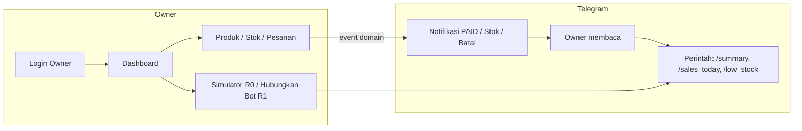
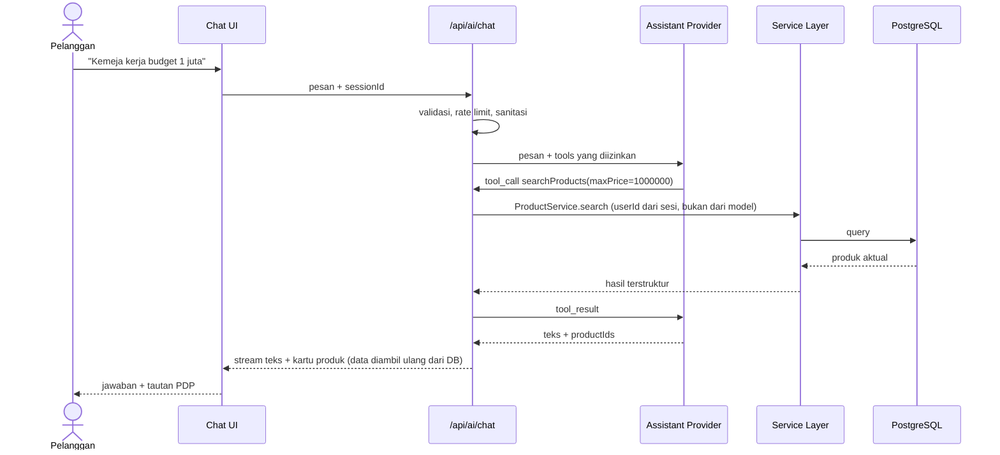

# Peran & Alur Pengguna

> Bagian G dan J: peran, hak akses, dan alur.  
> ← [Daftar dokumen](README.md)

## G. User Roles & Permissions

Platform melayani **satu brand**. Hanya ada dua peran berakun, ditambah pengunjung anonim:

| Peran                     | Cara identifikasi                                         | Cakupan                                                                                                               |
| ------------------------- | --------------------------------------------------------- | --------------------------------------------------------------------------------------------------------------------- |
| **Visitor** (tanpa login) | Tanpa sesi                                                | Browse, search, lihat Brand Story, bag (localStorage), AI Assistant untuk pertanyaan produk. **Tidak dapat checkout** |
| **Customer**              | Sesi Auth.js, `role=CUSTOMER`                             | Semua hak Visitor + checkout, alamat, riwayat & pelacakan pesanan, wishlist, review, status pesanan via AI            |
| **Owner**                 | `role=OWNER` (dibuat lewat seed, tanpa registrasi publik) | Seluruh area `/admin`, Telegram Business Assistant, audit log. Mencakup seluruh pengelolaan toko                      |

> Area pengelolaan tetap bernama `/admin` dan Server Action berawalan `admin*`; yang berhak mengaksesnya hanya peran `OWNER`. Peran `STAFF` (operasional pesanan/stok tanpa akses omzet) dicatat sebagai **Future** (D-13). Enum `Role` dibuat dapat ditambah tanpa mengubah guard.

| Kemampuan                                                           |        Visitor         |        Customer        |              Owner               |
| ------------------------------------------------------------------- | :--------------------: | :--------------------: | :------------------------------: |
| Browse / search / PDP / Brand Story                                 |           ✅           |           ✅           |                ✅                |
| Bag                                                                 |       ✅ (lokal)       | ✅ (tersimpan di akun) |                ✅                |
| Checkout & pembayaran                                               |  ❌ (diarahkan login)  |           ✅           |                ✅                |
| Wishlist, alamat, review                                            |           ❌           |           ✅           | ✅ (review dilarang untuk Owner) |
| Lihat pesanan sendiri                                               |           ❌           |           ✅           |                ✅                |
| Batalkan pesanan sendiri (saat `PENDING_PAYMENT`)                   |           ❌           |   ✅ (milik sendiri)   |                ✅                |
| AI: info produk/outfit/ukuran/FAQ                                   | ✅ (batas lebih ketat) |           ✅           |                ✅                |
| AI: status pesanan                                                  |           ❌           |   ✅ (milik sendiri)   |        ✅ (milik sendiri)        |
| Dashboard, CRUD produk/stok, ubah status pesanan, promo, pengaturan |           ❌           |           ❌           |                ✅                |
| Simulator/perintah/notifikasi Telegram, audit log                   |           ❌           |           ❌           |                ✅                |

Otorisasi ditegakkan di **service layer** lewat satu guard (`requireRole("OWNER")`, `requireUser()`); `proxy.ts` (konvensi middleware di Next.js 16) hanya lapisan pertama untuk `/admin` dan `/account`. Link "Dashboard" di header hanya tampil untuk Owner.

## J. User Flow

### J.1 Alur belanja (Visitor → Customer)

### J.2 Alur owner & Telegram

### J.3 Alur AI Assistant

Pada R0, `Assistant Provider` adalah `ScriptedAssistant`; pada R1 dapat diganti model AI tanpa mengubah tool atau service. Prinsip yang sama berlaku untuk Simulator Telegram dan transport bot R1.
