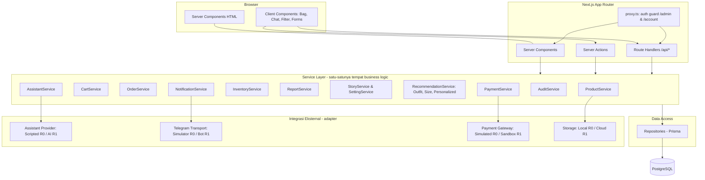
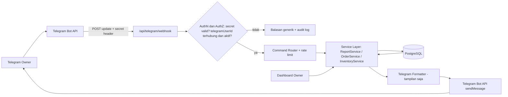
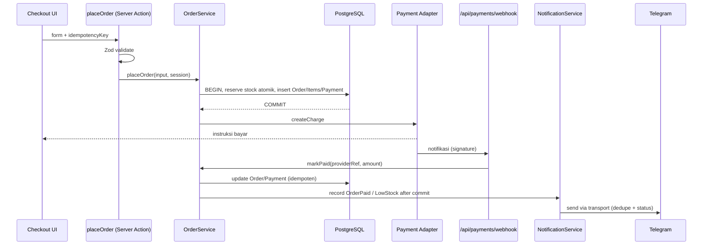

# Arsitektur Sistem & Struktur Proyek

> Bagian N dan P.  
> ← [Daftar dokumen](README.md)

## N. System Architecture

### N.1 Prinsip

Monolit modular di Next.js: **satu basis kode, satu database, dan satu service layer** yang dipakai UI, Route Handlers, Server Actions, Assistant Provider, serta transport Telegram. Tidak memakai microservice atau Clean Architecture penuh karena tidak sebanding dengan skala kompetisi.

### N.2 Diagram lapisan



### N.3 Tanggung jawab per lapisan

| Lapisan                                    | Tanggung jawab                                                                                                      | Dilarang                                                |
| ------------------------------------------ | ------------------------------------------------------------------------------------------------------------------- | ------------------------------------------------------- |
| `app/` pages & layouts (Server Components) | Mengambil data lewat service, komposisi UI, metadata                                                                | Query Prisma langsung; logika bisnis                    |
| Client Components                          | Interaksi (bag, chat, filter, form)                                                                                 | Mengakses secret; menghitung harga final                |
| Server Actions                             | Mutasi dari form UI: autentikasi → validasi Zod → panggil service → `updateTag` (Next.js 16)                        | Logika bisnis (hanya orkestrasi)                        |
| Route Handlers                             | Endpoint publik/eksternal: webhook (pembayaran, Telegram), cron, AI streaming, search → `revalidateTag(tag, "max")` | Duplikasi aturan bisnis                                 |
| **Service layer** (`server/services`)      | Aturan bisnis, otorisasi, transaksi, event domain                                                                   | Mengetahui HTTP/React                                   |
| Repository (`server/repositories`)         | Query Prisma; tanpa aturan bisnis                                                                                   | Otorisasi                                               |
| Integrations (`server/integrations`)       | Adapter scripted/simulator/lokal R0 dan provider eksternal R1 di balik interface                                    | Dipanggil langsung dari UI atau menyimpan business rule |
| `models/` (prototype)                      | Tipe domain, aturan murni (`productRules`), mapper                                                                  | Efek samping                                            |

Pola prototype (`getProducts` → mock/API fallback) **dihapus**. `ProductService` selalu membaca `ProductRepository`, dan repository selalu mengakses PostgreSQL melalui Prisma. Tipe serta aturan domain murni di `models/` tetap dipertahankan, tetapi file mock/seed tidak pernah menjadi dependency runtime.

**Server vs Client Components.** Default Server Component. `"use client"` hanya untuk: `CartProvider`, Header (menu), CartDrawer, QuickAdd, galeri, ShopBrowser (kontrol filter), Chat, form interaktif. Data awal diteruskan sebagai props serializable.

**Caching (Next.js 16).** Katalog, koleksi, dan Brand Story memakai cache tag (`products`, `collections`, `brand-story`, `store-settings`). Saat Owner atau Server Action melakukan mutasi, panggil `updateTag(tag)` agar perubahan langsung terbaca (_read-your-own-writes_); dari Route Handler (webhook/cron), panggil `revalidateTag(tag, "max")` atau `{ expire: 0 }`. Halaman akun/admin/dashboard tetap dinamis (tanpa cache).

> **Catatan transisi kode prototype:** Untuk pemetaan modul prototype yang harus dipindah atau dihapus (`src/models/services/*`, `src/models/api/httpClient.ts`, `src/models/data/*.mock.ts`), lihat tabel transisi di [docs/guides/00-start-here.md](../docs/guides/00-start-here.md).

**Error handling.** Service melempar `AppError` bertipe (`ValidationError`, `NotFoundError`, `ForbiddenError`, `ConflictError`); Server Action/Route Handler memetakannya ke `{ ok:false, code, message, fieldErrors }` / status HTTP (400/401/403/404/409/429/500). `error.tsx` per segmen untuk UI. Detail internal tidak bocor ke klien.

**Logging.** `logger` terstruktur (pino atau wrapper JSON), `requestId` per permintaan, level per lingkungan, dan redaction kunci sensitif (`password`, `token`, `authorization`, `secret`).

**Event setelah transaksi.** Service mencatat event domain setelah transaksi bisnis berhasil. Pada R0, `NotificationService` memprosesnya melalui transport simulator dan menyimpan `NotificationLog(PENDING→SENT/FAILED)`. R1 dapat menambahkan outbox/worker tanpa mengubah service pemicu. Kegagalan transport tidak boleh melakukan rollback pesanan atau pembayaran.

### N.4 Integrasi Telegram tanpa duplikasi logika

Dashboard dan Telegram memanggil **`ReportService` yang sama**; Telegram hanya _format_ (view) berbeda.



### N.5 Alur pembuatan pesanan & event



## P. Project Structure

Mempertahankan struktur UI (`components/{atoms,molecules,organisms,compound}`, `hooks`, `models`, `lib`) dan menambah sisi server. Folder `models/data/*.mock.ts` dihapus setelah data dimigrasikan ke PostgreSQL. Application code dilarang mengimpor `prisma/seed.ts` atau data bootstrap.

```text
.
├─ prisma/
│  ├─ schema.prisma
│  ├─ migrations/
│  └─ seed.ts                  # CLI bootstrap: upsert data awal ke DB; bukan runtime source
├─ public/                     # aset prototype (images/, icons/)
├─ src/
│  ├─ app/
│  │  ├─ (storefront)/         # /, collections/[slug], shop, shop/[slug], about, checkout
│  │  ├─ (account)/account/…   # profil, alamat, pesanan (+ detail), wishlist
│  │  ├─ (auth)/login|register
│  │  ├─ (owner)/admin/…       # dashboard & manajemen (khusus Owner)
│  │  ├─ api/
│  │  │  ├─ ai/chat/route.ts
│  │  │  ├─ telegram/webhook/route.ts
│  │  │  ├─ payments/webhook/route.ts
│  │  │  ├─ cron/{daily,weekly,monthly,expire-orders}/route.ts
│  │  │  ├─ products/search/route.ts
│  │  │  └─ health/route.ts
│  │  ├─ layout.tsx, globals.css, sitemap.ts, robots.ts, not-found.tsx
│  ├─ components/
│  │  ├─ atoms/ molecules/ organisms/ compound/    # dari prototype
│  │  ├─ providers/            # CartProvider, dll.
│  │  ├─ admin/                # DataTable, StatCard, SalesChart, …
│  │  └─ ui/                   # primitif shadcn (dibungkus token)
│  ├─ content/                 # copy.ts (kamus UI copy terpusat D-03)
│  ├─ hooks/                   # view-model hooks (pola prototype)
│  ├─ actions/                 # Server Actions per domain (cart, order, wishlist, admin-*)
│  ├─ validators/              # skema Zod (checkout, address, product, filter, ai)
│  ├─ models/                  # types, domain rules murni, mappers (tanpa React/Next/Prisma/fetch)
│  ├─ proxy.ts                 # auth redirect boundary Next.js 16 (/admin & /account)
│  ├─ server/
│  │  ├─ auth/                 # konfigurasi Auth.js, guard peran
│  │  ├─ db/                   # prisma client singleton
│  │  ├─ repositories/         # product, order, inventory, report, setting, story, …
│  │  ├─ services/             # product, cart, order, payment, inventory, report, setting, story,
│  │  │                        # outfit, size, personalization, notification, audit, assistant
│  │  ├─ integrations/
│  │  │  ├─ assistant/         # scripted R0, AI provider R1, tools, prompt
│  │  │  ├─ telegram/          # simulator/bot transport, router, formatter
│  │  │  ├─ payment/           # gateway interface, simulated, sandbox R1
│  │  │  ├─ shipping/          # ShippingProvider: tarif tetap + resi manual
│  │  │  └─ storage/           # local asset registry (R0) / cloud adapter (R1)
│  │  └─ lib/                  # errors, logger, rate-limit, idempotency
│  ├─ lib/                     # util klien/universal: cn, formatIDR, action-result, metadata, jsonLd, constants
│  └─ config/                  # env.ts (validasi env dengan Zod), site.ts
├─ tests/
│  ├─ unit/ integration/ e2e/
├─ .github/workflows/ci.yml    # lint, format:check, typecheck, build (+ jscpd, knip, test saat P1)
├─ eslint.config.mjs, .prettierrc, tsconfig.json
├─ prd/                        # dokumen ini
├─ docs/                       # guides, team/ownership, features
├─ CONTRIBUTING.md, AGENTS.md
└─ README.md
```

**Aturan dependensi (ditegakkan ESLint `no-restricted-imports`):** `components/hooks` dilarang mengimpor `@/server/*` atau `@prisma/client`; `models/` dilarang mengimpor `react`, `next/*`, `@/server/*`, atau `@prisma/client`; `actions → validators + services`; `services → repositories + integrations + models`; `repositories → db`.
