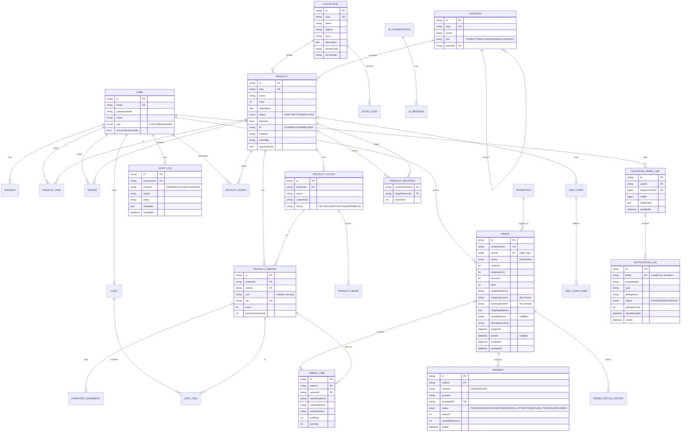

# Database & ERD

> Bagian M.  
> ← [Daftar dokumen](README.md)

## M. Database Design & ERD

### M.1 Keputusan desain

- **Uang** disimpan sebagai `Int` rupiah (minor unit IDR, tanpa sen/desimal; konsisten dengan `formatIDR`). Perhitungan diskon persentase (`FR-026`) dibulatkan ke bawah: `Math.floor((subtotal * percent) / 100)` dan tidak pernah melebihi subtotal. `OrderItem` menyimpan **snapshot** nama, harga, warna, ukuran agar riwayat tidak berubah.
- **Varian = (produk × warna × ukuran)**: `ProductVariant` memuat `stock`. Produk one-size memiliki `size = NULL`.
- Warna adalah entitas per produk (`ProductColor`) karena prototype memiliki gambar front/back per warna.
- **Stok tersedia** diubah hanya melalui `InventoryService`; stok awal, reserve, release, dan adjustment dicatat sebagai delta di `InventoryMovement`. Pembayaran tidak mengurangi stok untuk kedua kali.
- **Sumber kebenaran skema:** Setelah Foundation P1 selesai, `prisma/schema.prisma` adalah sumber kebenaran teknis skema database. Setiap perubahan `schema.prisma` wajib memperbarui dokumen ini pada PR yang sama.
- Tidak membuat tabel `Roles`: cukup enum `Role` (hanya 2 peran) — normalisasi berlebih dihindari.
- `AiConversation` **opsional**: disimpan hanya untuk evaluasi kualitas, dengan PII di-mask dan retensi 30 hari.
- Soft delete (`ARCHIVED`) untuk entitas yang direferensikan pesanan.

### M.2 ERD

_Entitas pendukung yang tidak digambar atribut lengkapnya di ERD di atas:_ `Account/Session/VerificationToken` (Auth.js), `WishlistItem`, `Review`, `Promotion`, `ProductRelation`, `SizeChart/SizeChartRow`, `ProductEvent` (VIEW/SEARCH; hanya opt-in), `TelegramLinkToken`, serta `AiConversation/AiMessage` (opsional).

#### Spesifikasi Enum & Entitas Pendukung Wajib R0

- **Enum `OrderStatus`:** `PENDING_PAYMENT | PAID | PROCESSING | SHIPPED | COMPLETED | CANCELLED | EXPIRED`
- **Enum `InventoryMovementType`:** `INITIAL | RESERVE | RELEASE | ADJUSTMENT`
- **Enum `NotificationType`:** `ORDER_PAID | LOW_STOCK | OUT_OF_STOCK | ORDER_CANCELLED_AFTER_PAID | PAYMENT_NEEDS_ATTENTION | UNPROCESSED_REMINDER | SCHEDULED_REPORT`
- **Struktur JSON `Order.shippingAddress`:** `{ recipientName: string, email: string, phone: string, street: string, apartment?: string, city: string, province: string, postalCode: string, notes?: string }`

| Entitas R0           | Atribut Lengkap                                                                                                                                            | Tujuan                                                                                   |
| -------------------- | ---------------------------------------------------------------------------------------------------------------------------------------------------------- | ---------------------------------------------------------------------------------------- |
| `ProductImage`       | `id PK`, `colorId FK`, `url`, `view ("FRONT" \| "BACK" \| "CONTEXT")`, `altText`, `sortOrder Int`                                                          | Galeri gambar produk per warna & konteks                                                 |
| `Cart` / `CartItem`  | `Cart(id PK, userId UK FK, updatedAt)` · `CartItem(id PK, cartId FK, variantId FK, quantity Int, UK(cartId, variantId))`                                   | Bag tersimpan akun Customer & merge                                                      |
| `Address`            | `id PK`, `userId FK`, `recipientName`, `phone`, `street`, `apartment?`, `city`, `province`, `postalCode`, `isDefault Bool`, `createdAt`                    | Buku alamat Customer (maks 5)                                                            |
| `InventoryMovement`  | `id PK`, `variantId FK`, `orderId FK?`, `actorUserId FK?`, `type (InventoryMovementType)`, `delta Int`, `reason`, `createdAt`                              | Ledger delta stok                                                                        |
| `OrderStatusHistory` | `id PK`, `orderId FK`, `fromStatus?`, `toStatus (OrderStatus)`, `actorUserId FK?`, `actorType ("CUSTOMER" \| "OWNER" \| "SYSTEM")`, `reason?`, `createdAt` | Timeline & jejak perubahan status pesanan                                                |
| `StoreSetting`       | `key PK`, `value Json`, `updatedAt`, `updatedById FK?`                                                                                                     | Tarif pengiriman (`standard`/`express`), `defaultLowStockThreshold`, konten `brandStory` |
| `StoryStep`          | `id PK`, `collectionId FK?` (`NULL` untuk story utama/about), `step Int`, `numberStr`, `title`, `headline`, `description`, `image`, `imageAlt`             | Langkah Pinned Cinema Story & Brand Story                                                |
| `OrderSequence`      | `period PK` (string `"YYMM"` zona `Asia/Jakarta`), `lastValue Int`                                                                                         | Counter atomik untuk nomor pesanan `{PREFIX}-{YYMM}-{NNNN}` (mis. `ZCT-2611-0001`)       |
| `RateLimitBucket`    | `key PK` (mis. `"login:ip:1.2.3.4"`, `"ai:user:xyz"`), `windowStart DateTime`, `count Int`                                                                 | Penyimpanan rate limit R0 konsisten lintas proses (NFR-07)                               |

### M.3 Indeks & constraint penting

| Tabel             | Constraint/Indeks                                                                                                                                         | Tujuan                                                     |
| ----------------- | --------------------------------------------------------------------------------------------------------------------------------------------------------- | ---------------------------------------------------------- |
| `Product`         | UK `slug`; indeks `(status, featured)`; GIN trigram pada `name`                                                                                           | Katalog & search                                           |
| `ProductVariant`  | UK fungsional `(productId, colorId, COALESCE(size,'ONE_SIZE'))`; `CHECK stock >= 0`; composite FK memastikan warna milik produk yang sama; indeks `stock` | Cegah duplikasi one-size/oversell dan varian lintas produk |
| `ProductRelation` | UK `(sourceProductId,targetProductId)`; `CHECK sourceProductId <> targetProductId`                                                                        | Cegah relasi duplikat dan self-reference                   |
| `Order`           | UK `orderNumber`, UK `(userId,idempotencyKey)`; indeks `(status,createdAt)` dan `(userId,createdAt)`                                                      | Idempotensi per pengguna & riwayat                         |
| `Payment`         | UK `providerRef`                                                                                                                                          | Idempotensi webhook                                        |
| `NotificationLog` | UK `(recipientKey,dedupeKey)`; indeks `(status,nextAttemptAt)`                                                                                            | Anti-duplikat untuk simulator maupun bot & retry           |
| `WishlistItem`    | UK `(userId, productId)`                                                                                                                                  | Idempotensi                                                |
| `Review`          | UK `(userId, productId)`                                                                                                                                  | Satu ulasan per pembeli                                    |

### M.4 Dukungan kebutuhan

| Kebutuhan            | Dukungan                                                                                                                                             |
| -------------------- | ---------------------------------------------------------------------------------------------------------------------------------------------------- |
| Transaksi            | `placeOrder` memakai `prisma.$transaction` + `UPDATE ... SET stock = stock - n WHERE stock >= n` (atomik) + upsert/increment `OrderSequence(period)` |
| Pemantauan penjualan | Agregasi Payment `PAID` berdasarkan `paidAt` (zona `Asia/Jakarta`); `REFUND_PENDING` dilaporkan terpisah dan `REFUNDED` dikeluarkan dari net sales   |
| Monitoring stok      | `ProductVariant.stock` vs `lowStockThreshold`                                                                                                        |
| Telegram             | `TelegramAdminLink`, `NotificationLog`, `AuditLog`                                                                                                   |
| Rekomendasi          | `Category.slot`, `Product.styleTags/fit`, `ProductColor.family`, `SizeChart`, `ProductEvent`                                                         |
| Riwayat pesanan      | `Order` + `OrderItem` snapshot + `OrderStatusHistory`                                                                                                |

### M.5 State machine pesanan

```mermaid
stateDiagram-v2
  [*] --> PENDING_PAYMENT
  PENDING_PAYMENT --> PAID: PaymentService (simulator/webhook valid)
  PENDING_PAYMENT --> EXPIRED: lewat 24 jam
  PENDING_PAYMENT --> CANCELLED: batal
  PAID --> PROCESSING: owner
  PAID --> CANCELLED: owner + reason; refund pending
  PROCESSING --> SHIPPED: resi diinput
  PROCESSING --> CANCELLED: owner + reason; refund pending
  SHIPPED --> COMPLETED: diterima
  EXPIRED --> [*]
  CANCELLED --> [*]
  COMPLETED --> [*]
```

Pemetaan istilah Telegram: _Menunggu_ = `PAID` (belum diproses) + `PENDING_PAYMENT` ditampilkan terpisah sebagai "Menunggu pembayaran"; _Diproses_ = `PROCESSING`; _Selesai_ = `SHIPPED/COMPLETED`.

### M.6 Invariant transaksi

1. Order menjadi `PAID` hanya melalui `PaymentService`; UI Owner tidak boleh melewati aturan ini kecuali adapter simulasi aktif di environment demo.
2. Reserve stok dan pembuatan Order/OrderItem/Payment berada dalam satu transaksi database.
3. Expire/cancel melepaskan stok tepat satu kali; idempotensi diverifikasi dari riwayat movement.
4. Pembatalan setelah bayar membuat Payment `REFUND_PENDING`; setelah bukti refund dicatat status menjadi `REFUNDED`.
5. `ProductVariant.stock` adalah cache stok tersedia dan harus sama dengan jumlah delta seluruh `InventoryMovement`. Reserve mengurangi stok; expire/cancel melepaskannya; pembayaran tidak membuat decrement kedua.
