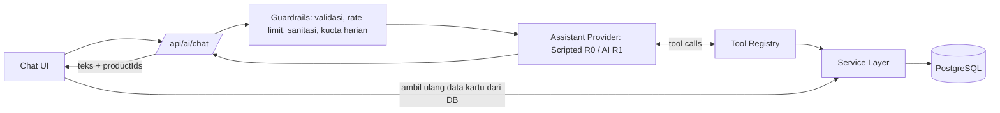

# AI Shopping Assistant

> Bagian S.  
> ← [Daftar dokumen](README.md)

## S. Shopping Assistant Specification

R0 memakai `ScriptedAssistant` deterministik. R1 dapat memakai model AI dengan tool-calling. Keduanya mengimplementasikan interface dan guardrail yang sama sehingga UI, service, tool, serta pengujiannya tidak perlu ditulis ulang.

### S.1 Arsitektur

Pola **Tool-calling Agent terbatas**: model **tidak** punya akses DB; ia hanya memanggil *tools* yang dipublikasikan server. Tools memanggil service layer yang sama dengan UI (otorisasi sama).

### S.2 Mengapa tidak mengarang data

1. **Kartu produk dirender dari DB**, bukan dari teks model: model hanya mengembalikan `productIds`; harga/stok/ukuran pada kartu selalu hasil query.
2. R0 membentuk angka langsung dari DTO service. Pada R1, system prompt dan `post-check` melarang angka harga/stok yang tidak ada di hasil tool terakhir; nilai yang tidak cocok dihapus dan diganti tautan produk.
3. Tool mengembalikan `availability` eksplisit; bila kosong, jawaban wajib menyatakan ketidaktersediaan.
4. Informasi di luar data ("apakah bahan ini tahan luntur?") → jawab "tidak tersedia di data kami".

### S.3 Pemetaan kemampuan brief → tool/aturan

| # | Kemampuan (brief §6.A) | Mekanisme | Sumber |
|---|---|---|---|
| 1 | Cara memakai platform | `getHowToGuide(topic)` — FAQ statis tervalidasi | Konten statis |
| 2 | Cari produk sesuai kebutuhan | `searchProducts({query, category, maxPrice, size, color})` | `ProductService` |
| 3 | Rekomendasi gaya/preferensi | `searchProducts` + `styleTags`; saran dijelaskan | Atribut produk |
| 4 | Rekomendasi sesuai anggaran | filter `maxPrice` / `minPrice` | DB |
| 5 | Detail produk/warna/bahan/ukuran | `getProductDetail(slug)` | DB (`specifications`, varian) |
| 6 | Bandingkan produk | `compareProducts(slugs[2..3])` → tabel atribut | DB |
| 7 | Kombinasi outfit | `getOutfit(productSlug)` → `OutfitService` | Aturan (FR-033) |
| 8 | Proses checkout | `getHowToGuide("checkout")` | Konten statis |
| 9 | Status pesanan | `getMyOrderStatus(orderNumber)` — `userId` **diambil dari sesi server**, bukan parameter model; hanya Customer login | `OrderService` |
| 10 | Arahkan ke halaman | Kartu/tautan `/shop/[slug]` | Router |
| + | Rekomendasi ukuran | `recommendSize(slug, heightCm, weightKg, fit)` → `SizeService` | Size chart (FR-034) |

### S.4 Batasan akses

- Tidak ada tool untuk pembayaran, mengubah pesanan, menulis ke DB, atau membaca data pelanggan lain. Semua tool **read-only**.
- Untuk Visitor, tool pesanan tidak dipublikasikan; bila ditanya, asisten mengarahkan ke login.
- Argumen tool divalidasi Zod; nilai di luar rentang ditolak.
- Konten dari DB (nama/deskripsi) diperlakukan sebagai data, bukan instruksi (mitigasi *prompt injection* tidak langsung); output tool dibungkus penanda data.

### S.5 Konfigurasi & biaya

`ASSISTANT_MODE=scripted|ai`, `AI_PROVIDER`, `AI_MODEL`, `AI_API_KEY` (server only), `AI_DAILY_REQUEST_CAP`, `AI_TIMEOUT_MS=15000`. R0 selalu dapat berjalan dengan `scripted`. Model R1 dipilih lewat PoC berdasarkan kualitas tool-calling bahasa Indonesia, latensi, biaya, kuota, dan kebijakan data. Fallback: scripted intents, FAQ, dan pencarian biasa.

### S.6 Privasi

Log percakapan **tidak wajib**; bila diaktifkan: PII di-mask (email, telepon, alamat, nomor pesanan sebagian), retensi 30 hari, opsi hapus. Data pesanan dikirim ke model hanya sebagai hasil tool minimal (status, item, tanggal) — tanpa alamat/telepon.

### S.7 Validasi respons AI (set uji)

Set ≥ 40 prompt tetap (ID/EN) mencakup pencarian, anggaran, perbandingan, outfit, ukuran, FAQ, status pesanan, di luar domain, prompt injection, produk tidak ada, dan stok habis. Kriteria: (a) 100% harga/stok kartu sesuai DB; (b) 0 kebocoran lintas user; (c) 0 aksi tulis; (d) ≥ 90% jawaban relevan menurut rubrik dua penilai; (e) TTFB R1 ≤ 3 dtk pada kondisi normal. R0 diuji terhadap `ScriptedAssistant`; R1 menambahkan model stub otomatis dan uji manual provider nyata.
